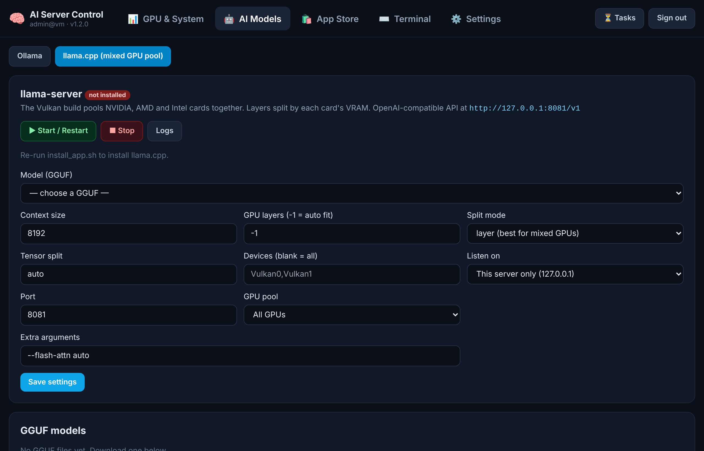
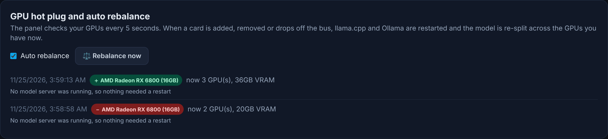
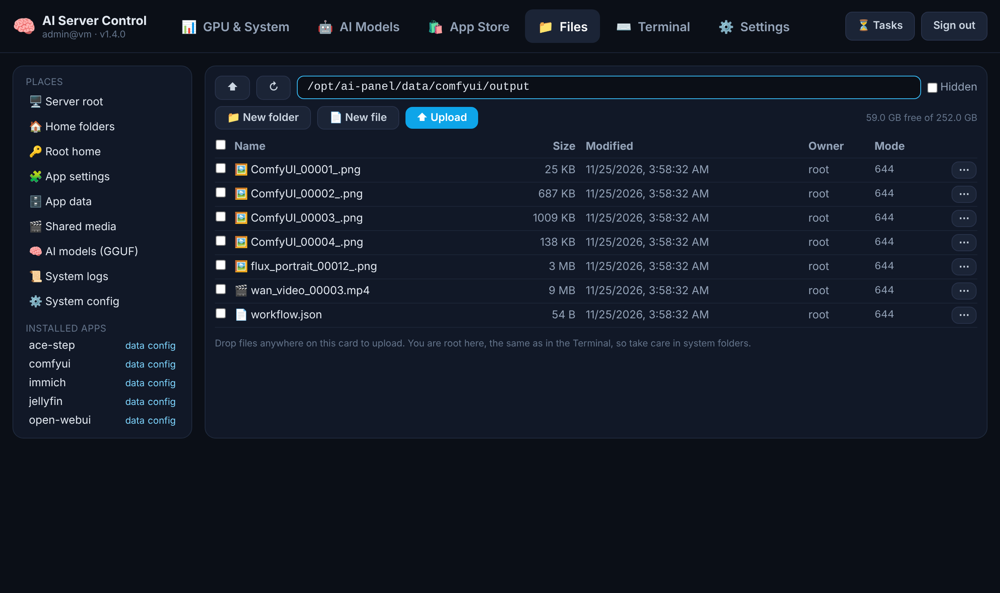
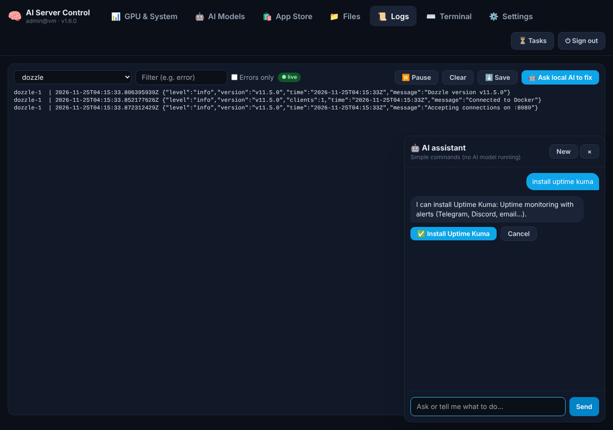
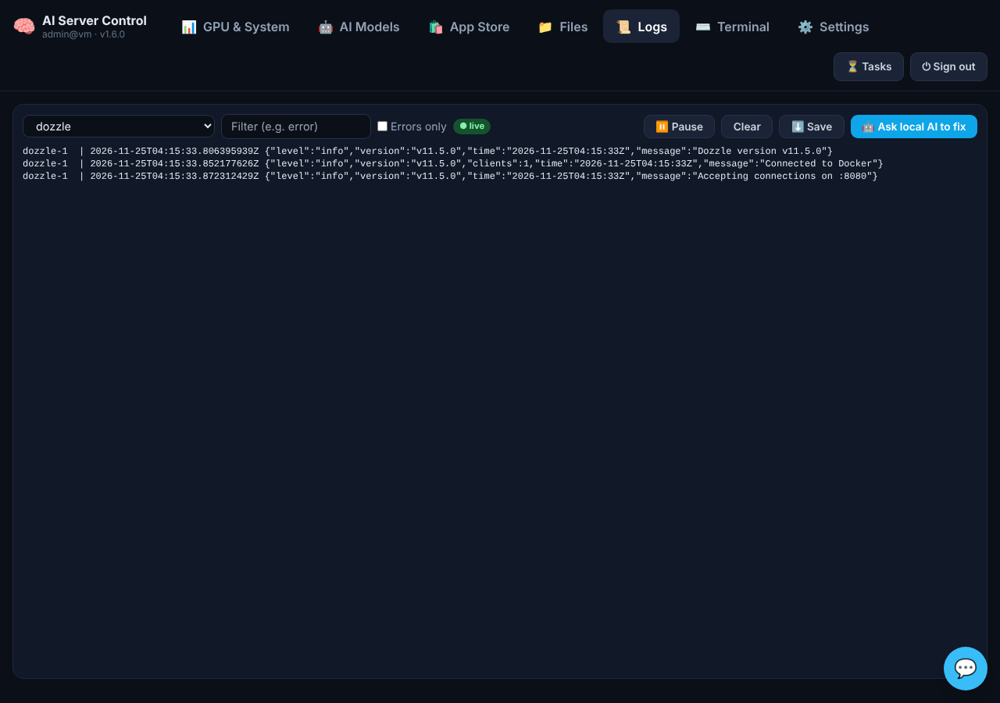
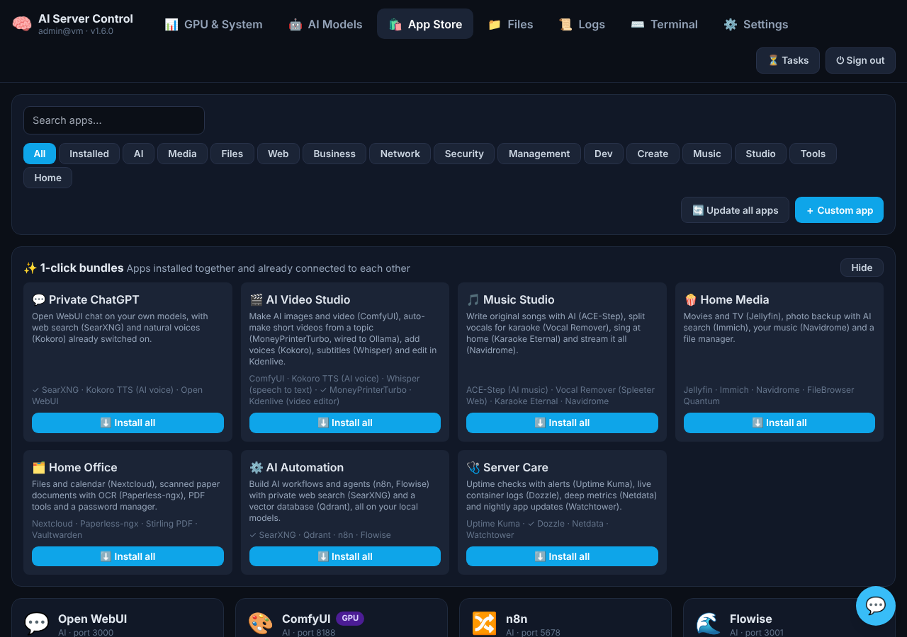
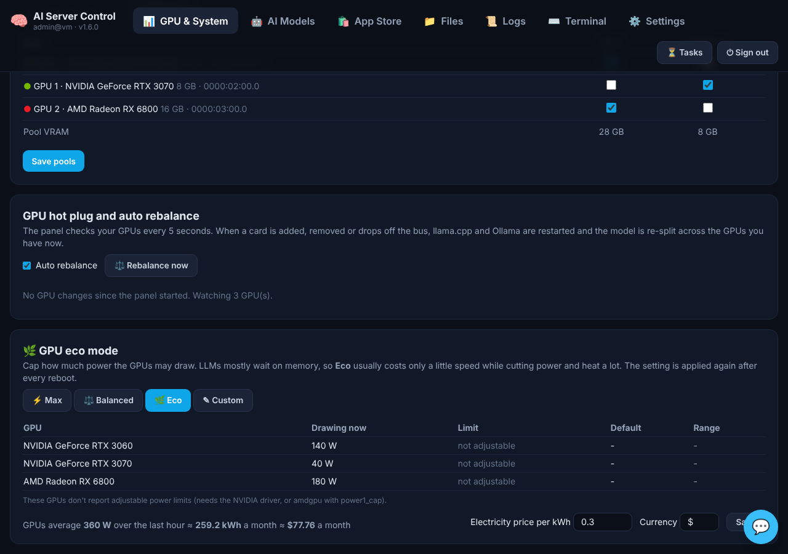
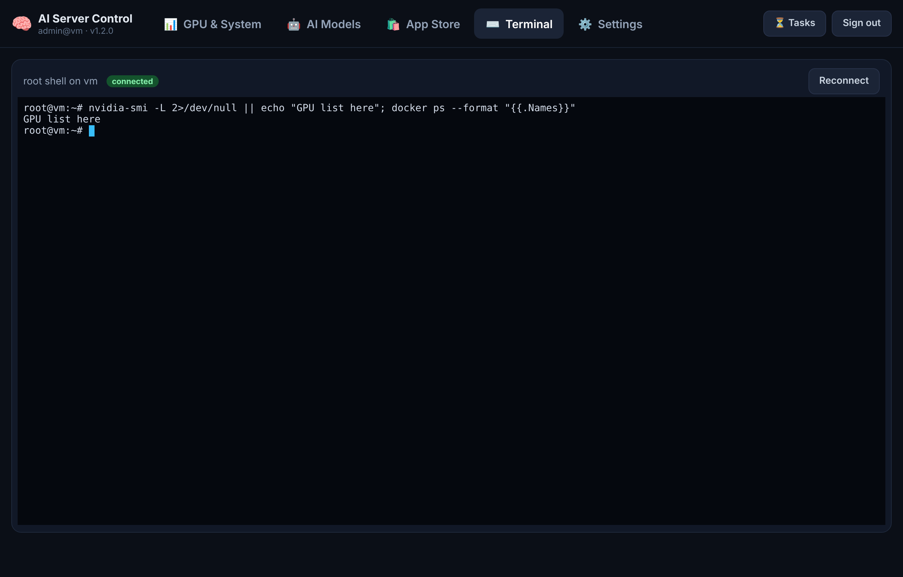

<div align="center">

# 🧠 AI Server Control Panel

### Every GPU you own. One AI server. One browser tab.

**Mix NVIDIA, AMD and Intel cards into one big pool of VRAM, run big local LLMs on it, and manage the whole server from your browser. No SSH, no cloud, no monthly bill.**


</div>

```bash
curl -fsSL https://raw.githubusercontent.com/nnlahpai-ai-control-panel/Ai-Control-Panel/main/install_app.sh -o install_app.sh
sudo bash install_app.sh
```

Two commands. About ten minutes later you open `http://your-server:1234` and you're in.


## ✨ Why people use it

### 🧩 Automatic VRAM pooling for any GPU
That RTX 3060 in your desktop, the RX 6800 from your last build and the old GTX 1080 in the drawer can all work on **one model together**. The panel finds every card, reads its VRAM, and splits the model across them for you: **12GB + 16GB + 8GB = 36GB** of VRAM for one LLM. NVIDIA, AMD and Intel can all be in the same pool, through llama.cpp's Vulkan backend. You don't have to work out a single split ratio.

### 🔌 GPU hot plug and auto rebalance
The panel checks your GPUs every 5 seconds. If a card is added, removed, or crashes and drops off the bus, it notices within about 10 seconds. It then restarts llama.cpp and Ollama and **re-splits the model across the GPUs you have now**. Your AI keeps running on what's left instead of crashing. Every change shows on the dashboard with a timestamp, and you can turn it off or press **Rebalance now** whenever you like.

### 🎛️ GPU pools: AI cards vs media cards
Put your fast cards in an **AI** pool for LLMs and image models, and an older card in a **Media** pool for Jellyfin and Immich. Each engine and app only touches the cards you give it.

### 🛍️ 52 one-click apps, with GPU passthrough
Open WebUI, ComfyUI, InvokeAI, n8n, Immich, Jellyfin, Nextcloud, WordPress, Home Assistant, Cloudflare Tunnel and many more. Apps that use the GPU get NVIDIA or AMD passthrough in one click. You can also bring your own Docker Compose file, from your computer or a URL.

### 🎬 A creative studio in your browser
Make **AI images** (ComfyUI, Fooocus, InvokeAI), **AI music and songs** (ACE-Step), **auto-generated short videos** (MoneyPrinterTurbo), subtitles, voice-overs and translations. Then edit them in **Kdenlive, Blender, GIMP or Krita**, running in a browser tab. Everything runs on your own GPUs, and the songs and images you make stay yours.

### 🤖 An AI assistant that runs your server
Type "install Dozzle", "make a 30 second video about the ocean", "set GPUs to eco" or "why did Jellyfin crash?" in the chat box. Your **own local model** picks the right action, and **nothing changes until you press the button** to confirm.

### 📜 Live logs, and a local AI that explains the fix
Watch any app, the AI engines, the proxy or the system journal live, filter it, or show only errors. Press **🤖 Ask local AI to fix** and your own model reads the errors and tells you the cause and the fix, with no data leaving your server.

### 🎁 1-click pre-wired bundles
Install a whole stack in one click, already connected together. **Private ChatGPT** gives you Open WebUI with SearXNG web search and Kokoro voice, all wired up. There are also bundles for an AI video studio, a music studio, home media, home office, AI automation and server care.

### 🌱 GPU eco mode
Choose Max, Balanced, Eco or your own watt limit per card. The panel shows live watts, kWh per day and the cost per month in your currency, and keeps your limits after a reboot.

### 📱 Phone friendly, with Telegram, Discord and ntfy alerts
The panel works on a phone and can be added to the home screen like an app. Get alerts when a GPU runs hot, a disk fills up, an app crashes or a GPU disappears. Control the server from **Telegram**: `/status`, `/apps`, `/restart_app jellyfin`, or just chat with your AI assistant, with a confirm button.

### 📁 A file manager for the whole server
Browse every folder on the server and every app's data. Edit config files, upload by drag and drop, download whole folders as zip, preview photos, videos and PDFs, and fix permissions. There's no FTP or SSH to set up.

### 🌐 1-click domains with automatic HTTPS
Type `chat.example.com`, pick an app, click **Add**. The panel runs a Caddy proxy that gets a free Let's Encrypt certificate and renews it for you. That works for the panel itself or any app. Home-only names like `nas.lan` get their own local certificate.

### 👥 Users and roles
Give family, friends or your team their own login. **Admins** run everything. **Users** only see the apps you give them, for example just Open WebUI or just Jellyfin. They can open, start, stop, restart and update those apps, and nothing else: no terminal, no files, no installs.

### 🛍️ Bring your own app store
Add more app catalogs by URL, such as your own GitHub repo, a friend's list or a community catalog. Their apps appear next to the built-in ones, with a label showing where they came from.

### 📊 See everything, set up nothing
Every GPU, drive, fan and network port is found on its own and shown live, with history charts. That includes temperature, power, VRAM, SMART drive health, SSD wear and dying-disk warnings.

### ⌨️ Root terminal in the browser, and one-click updates
You get a full shell with no SSH client. Update one app, every app, the AI engines or the panel itself with one click.

| | |
|---|---|
|  |  |
| **Mixed-GPU llama.cpp**: NVIDIA + AMD + Intel in one model | **App Store**: 52 apps with GPU passthrough |
|  |  |
| **Hot plug and auto rebalance** | **File manager** for the OS and every app |
|  |  |
| **AI assistant**: asks before it acts | **Live logs** with "Ask local AI to fix" |
|  |  |
| **1-click bundles**, pre-wired | **GPU eco mode** with kWh and cost |
|  |  |
| **GPU pools**: "AI" cards vs "Media" cards | **Browser terminal**: full root shell |

*Screenshots use demo GPU data.*

### How it compares

| | AI Server Control Panel | Doing it by hand | Generic home-server panels |
|---|:-:|:-:|:-:|
| Pool NVIDIA + AMD + Intel VRAM for one LLM | ✅ automatic | ⚠️ hours of flags | ❌ |
| Re-split models when a GPU appears or dies | ✅ | ❌ | ❌ |
| GPU pools per app and engine | ✅ | ⚠️ manual env vars | ❌ |
| Ollama + llama.cpp model manager | ✅ | ⚠️ CLI | ❌ |
| 1-click apps with GPU passthrough | ✅ 52 apps | ❌ | ✅ (no GPU choice) |
| SMART, GPU, fan and network monitoring | ✅ | ⚠️ many tools | ⚠️ basic |
| Domains + automatic HTTPS in one click | ✅ | ⚠️ proxy config by hand | ⚠️ some |
| Users who can only control their own apps | ✅ | ❌ | ⚠️ some |
| Add your own app store catalogs | ✅ | ❌ | ⚠️ some |
| Local AI chat that installs and controls apps | ✅ asks first | ❌ | ❌ |
| Live logs with AI explanation | ✅ local model | ⚠️ read it yourself | ⚠️ logs only |
| Pre-wired app bundles | ✅ 7 bundles | ❌ | ❌ |
| GPU power limits and energy cost | ✅ | ⚠️ nvidia-smi by hand | ❌ |
| Phone alerts and Telegram control | ✅ | ❌ | ⚠️ some |
| Runs on your existing Ubuntu, no new OS | ✅ | ✅ | ⚠️ some replace the OS |

**Feedback wanted!** If you try it, please [share a hardware report](../../issues/new?template=hardware_report.yml), [report a bug](../../issues/new?template=bug_report.yml), [request an app](../../issues/new?template=app_request.yml) or star ⭐ the repo. Reports from mixed NVIDIA + AMD rigs and older cards (GTX 10xx, Tesla) help most. See [CONTRIBUTING.md](CONTRIBUTING.md).

---

A self-contained web panel for an existing Ubuntu Server 24.04 / 26.04. It manages local AI models, Docker apps, multi-GPU telemetry, files and a browser terminal, all on **port 1234**. It does not change the kernel and needs no custom ISO. It runs as systemd services under `/opt/ai-panel`.

It works the same on **Ubuntu Desktop** 24.04 / 26.04. The panel runs in the background, and you open it in any browser, on the machine itself (http://localhost:1234) or from another device.

## System monitor (all detected automatically)

The **GPU & System** tab finds every piece of hardware on its own. Nothing needs to be configured, and new drives, cards or network ports show up automatically.

| Section | What it shows |
|---|---|
| GPUs | Each card's name, VRAM, utilization, temperature and power, plus the combined VRAM pool |
| CPU / RAM | Usage, CPU temperature and clock, RAM and swap |
| History charts | The last 5 min, 30 min or 1 hour of CPU, RAM, temperatures, GPU load and VRAM, network and drive speed |
| Hardware | Motherboard, BIOS, CPU cores, each RAM stick (size, type, speed, slot), and the PCI cards (GPUs, network, storage controllers) |
| Drives | Every HDD, SSD and NVMe drive with its type, size, partitions and usage, live read/write speed and busy %, plus **SMART health** (healthy or failing), temperature, power-on days, SSD wear %, TB written, and warnings for bad sectors |
| Network | Every port with its IP, link speed, live in/out speed and totals. Docker and VPN interfaces are hidden unless you tick "show". |
| Fans | Fan RPM where the motherboard reports it |

Drive health uses `smartmontools`, and RAM stick details use `dmidecode`. The installer adds both. For even deeper monitoring with alerts, install **Netdata** or **Uptime Kuma** from the App Store.

## What's in this repo

| File | What it is |
|---|---|
| `install_app.sh` | 1-step installer and upgrader (Docker, NVIDIA toolkit, Ollama, llama.cpp Vulkan, systemd) |
| `app.py` | FastAPI backend (auth, Ollama, llama.cpp, App Store, GPU stats, WebSocket terminal, updates) |
| `apps_catalog.json` | 52 one-click apps |
| `index.html` | Dark-mode single-page dashboard |
| `static/` | Tailwind CSS and xterm.js served locally, so the panel works without internet in the browser |

## Install (3 lines)

On a fresh Ubuntu Server, run:

```bash
curl -fsSL https://raw.githubusercontent.com/nnlahpai-ai-control-panel/Ai-Control-Panel/main/install_app.sh -o install_app.sh
sudo bash install_app.sh
echo "Open http://$(hostname -I | awk '{print $1}'):1234  (login printed above)"
```

The installer downloads the panel files from this GitHub repo. It also sets this repo as the panel's update source, so **Settings > Update panel** and **Refresh app catalog** pull your latest pushes.

Without internet access to GitHub, copy the folder over instead:

```powershell
scp -r "D:\Ai server Control" YOUR_USER@SERVER_IP:~/ai-panel      # run on Windows
```
```bash
cd ~/ai-panel && sudo bash install_app.sh                          # run on the server
```

The installer prints the URL and a random `admin` password. The password is also saved in `/opt/ai-panel/initial_password.txt`. Change it in **Settings** after your first login. If an NVIDIA driver was installed, reboot once.

Installer options: `--port 1234`, `--no-drivers`, `--update-engines`, `--source URL`.
Running the installer again upgrades in place and keeps your login, apps, models and settings.

## Mixed GPUs (NVIDIA + AMD + Intel together)

* **llama.cpp (AI Models > llama.cpp)** is the engine that pools *different vendors* into one model. The installer uses the official **Vulkan** build. Every card shows up as `Vulkan0`, `Vulkan1`, and so on. With **Tensor split = auto**, layers are split by each card's total VRAM: 8GB + 12GB + 16GB becomes `--tensor-split 8,12,16`, so 36GB is pooled. Use `fit` to let llama.cpp decide from free memory, or type your own ratio. **GPU layers = -1** lets llama.cpp fit as many layers as VRAM allows and puts the rest in RAM. That is how 30GB+ models still run.
* **Ollama** spreads a model across all GPUs of the **same** vendor (`OLLAMA_SCHED_SPREAD=1` is set). To try Ollama across vendors, uncomment `OLLAMA_VULKAN=1` in `/etc/systemd/system/ollama.service.d/ai-panel.conf` (experimental). Then run `systemctl daemon-reload && systemctl restart ollama`.
* llama-server exposes an OpenAI-compatible API at `http://127.0.0.1:8081/v1`. Open WebUI is pre-wired to both Ollama and llama.cpp.
* Docker apps that use a GPU (ComfyUI, Immich ML, Jellyfin) get NVIDIA (CUDA) *or* AMD (ROCm) passthrough. You choose which in the install dialog, because container images are vendor-specific.

### GPU hot plug and auto rebalance: how it works

* Every 5 seconds the panel lists the GPUs by PCI slot. A change has to last 10 seconds to count, so a single slow reading doesn't trigger anything.
* When a GPU appears or disappears, the panel:
  1. logs the event on **GPU & System > GPU hot plug** (what was added or removed, and the new GPU count and VRAM total),
  2. restarts **llama.cpp** with a new `--tensor-split` for the GPUs that are left (or for its GPU pool), if it was running with Tensor split = auto or fit,
  3. restarts **Ollama**, and re-applies its GPU pool if it has one, so it spreads models over the new set of cards.
* Typical triggers: a card falls off the bus after a driver crash (NVIDIA "Xid 79"), an eGPU over Thunderbolt or OCuLink is plugged in or out, a driver is reloaded, or you swap cards and reboot.
* Real PCIe hot plug of a desktop card while the machine is on needs a motherboard and riser that support it. Most consumer boards don't, so power off to add or remove internal cards. The panel rebalances on the next boot either way.
* Turn it off with the **Auto rebalance** switch if you'd rather restart things yourself. **Rebalance now** re-splits on demand, for example after you change GPU pools.
* If llama.cpp has a fixed device list (Devices field), the panel leaves it alone and tells you, because device numbers can change when cards change.
* Docker apps that were given a specific GPU keep that setting. Use ⋯ > Reconfigure on the app if its GPU is gone.

### How many GPUs can be pooled?

| | |
|---|---|
| **Recommended** | **2 to 6 GPUs** (works best, easy to power and cool) |
| Software limit | about 15 mixed GPUs (llama.cpp Vulkan supports 16 devices, and 1 backend slot goes to the CPU) |
| Real limit | your motherboard slots and PCIe lanes, power supply and cooling |

Tips for a good pool:
* Any count and any sizes work, for example 8+12+16GB, 6+24GB or 4x16GB. The panel detects each server's cards and splits by its real VRAM.
* With the default **layer** split, the cards take turns, so x1 risers are fine. But the **slowest card sets the speed**. A small old card adds VRAM and can make generation slower, so only add it if you need the memory.
* Each card draws 150 to 450W. Size the power supply for all cards at full load plus 20%.
* Above 6 cards, expect more setup trouble (BIOS "Above 4G decoding" and "Resizable BAR", riser stability) and smaller speed gains per card.

### Multiple GPU pools (for example "AI" and "Media")

You can split your cards into named groups so that different work runs on different GPUs. For example:

| Pool | GPUs | Used by |
|---|---|---|
| **AI** | RTX 3060 12GB + RX 6800 16GB (28GB) | llama.cpp, Ollama, ComfyUI |
| **Media** | RTX 3070 8GB | Jellyfin transcoding, Immich face/photo AI |

How to set it up:
1. **GPU & System tab > GPU pools:** add a pool, tick its GPUs and click **Save pools**. Any number of pools works, and a GPU can be in more than one pool.
2. **AI Models > llama.cpp:** choose the pool in **GPU pool**, then click Start / Restart. The model splits only across that pool's cards.
3. **AI Models > Ollama:** choose the pool and click **Apply**. Ollama restarts and uses only those cards.
4. **App Store:** when you install a GPU app (or use ⋯ > Reconfigure), pick its **GPU pool**. Only that pool's cards are passed into the container.

Notes:
* GPUs are tracked by PCI slot, so pools stay correct after reboots, but update them if you move a card to another slot.
* "All GPUs" (no pool) is the default everywhere.
* A container uses one vendor, so for a mixed pool the app picks NVIDIA or AMD cards (the GPU passthrough option).
* After changing a pool's members, restart llama.cpp, click Apply for Ollama again, and Reconfigure the apps that use it.

## File manager (Files tab)

* **Places:** server root, home folders, every app's settings and data, shared media, AI models, system logs, `/etc` and every mounted drive with its free space.
* **Installed apps:** each one has a **data** and a **config** link, and every app's ⋯ menu has a **📁 Files** button that jumps straight to its folder.
* Open folders, edit text and config files in the browser (Ctrl+S saves), and preview photos, video, audio and PDFs.
* Upload many files at once, by button or by dragging them onto the page. Large files are streamed, with a progress bar.
* Download any file, or a whole folder as a `.zip`. Rename, move, copy, create, delete, and change permissions and owner.
* It runs as root, like the terminal. To stop accidents, it refuses to delete, move or zip top-level system folders such as `/`, `/etc`, `/usr` and `/opt/ai-panel`. You can still do that from the Terminal if you really mean it.
* Prefer a separate file app with users, share links and video thumbnails? Install **FileBrowser Quantum** from the App Store. It shows all app data and shared media.

## Users and roles (Settings > Users and roles)

| | Admin | User |
|---|:-:|:-:|
| GPU & System, AI Models, Files, Terminal | ✅ | ❌ |
| See apps | all | only the apps ticked for them |
| Open, start, stop, restart, update, logs, secrets | ✅ | ✅ for their apps |
| Install, reconfigure, uninstall apps, domains | ✅ | ❌ |
| Users, updates, app sources | ✅ | ❌ |

* Older installs keep working: the existing `admin` stays an admin.
* You can't delete or demote the last admin, or yourself.
* A user's task list only shows their own tasks.
* Forgot the admin password? `sudo /opt/ai-panel/venv/bin/python /opt/ai-panel/app.py --set-password admin NEWPASSWORD && sudo systemctl restart ai-panel`

## Domains and automatic HTTPS (Settings > Domains, or an app's ⋯ > Domain + HTTPS)

1. At your DNS provider, add an **A record**: `chat.example.com` → your public IP. The panel shows your IP.
2. On your router, forward TCP ports **80 and 443** to the server.
3. Click **Add domain**, type it, and pick the panel or an app. The panel starts a **Caddy** container (`aipanel-proxy`, host network) that gets the Let's Encrypt certificate and renews it on its own.

* The DNS column turns green ✓ when the domain points at this server.
* **Local network only** makes a certificate from the panel's own CA, for names like `nas.lan` that only your router knows. Browsers warn once until you trust it.
* Ports 80 and 443 must be free, so stop Nginx Proxy Manager or another web server first.
* Behind CGNAT, or can't open ports? Use **Cloudflare Tunnel** from the App Store instead.
* The Caddy config is at `/opt/ai-panel/proxy/Caddyfile`. The panel rewrites it, so change domains in the UI.

## Extra app store sources (Settings > App store sources)

* Paste a URL to any JSON file in the `apps_catalog.json` format (`{"apps": [...]}`). A plain GitHub repo link works if `apps_catalog.json` is at the top of the repo.
* Apps with a bad id or an invalid compose file are skipped and counted. If an app id is already in the built-in catalog, the built-in app wins.
* **Refresh all**, and **Settings > Refresh app catalog**, re-download every source.
* Only add sources you trust: their apps run as Docker containers on your server.

## AI assistant (💬 button, bottom right, admins only)

* Pick the model in **Settings > AI assistant**. "Auto" uses Ollama and picks a model that can use tools. **qwen3:8b**, llama3.1:8b or qwen2.5:7b work well. If llama.cpp serves the model, start it with `--jinja` so tool calls work.
* It can show status, list and install apps or bundles, start, stop, restart or update apps, read logs, pull models, set GPU power, add a domain and **create a video** (through MoneyPrinterTurbo, saved to the shared `videos` folder).
* Anything that changes the server shows a **Confirm** button first. Nothing runs until you press it, and the button expires after an hour.
* No model yet? Short commands such as `install dozzle`, `restart jellyfin` or `status` still work.

## Live logs (Logs tab)

* Sources: each installed app, Ollama, llama.cpp, the panel, the HTTPS proxy, system errors and the kernel (for GPU and driver errors).
* Filter by text, show **errors only**, pause, clear or save to a file. Users see logs only for their own apps.
* **🤖 Ask local AI to fix** sends the last lines to your own model, which explains the cause and the commands to fix it. With no model, it shows the matching error lines.

## 1-click bundles (App Store, top row)

| Bundle | Apps | Wired together |
|---|---|---|
| 💬 Private ChatGPT | Open WebUI, SearXNG, Kokoro TTS | Web search and voice already on in Open WebUI |
| 🎬 AI video studio | ComfyUI, Kokoro, Whisper, MoneyPrinterTurbo, Kdenlive | MoneyPrinter uses your Ollama model |
| 🎵 Music studio | ACE-Step, Spleeter Web, Karaoke Eternal, Navidrome | Shared media folder |
| 🏠 Home media | Jellyfin, Immich, Navidrome, File Browser | GPU transcoding and photo AI |
| 🗂️ Home office | Nextcloud, Paperless-ngx, Stirling PDF, Vaultwarden | |
| ⚙️ AI automation | SearXNG, Qdrant, n8n, Flowise | Search and vector database ready |
| 🛠️ Server care | Uptime Kuma, Dozzle, Netdata, Watchtower | Nightly updates |

Apps you already have are skipped, and their passwords are kept.

## GPU eco mode (GPU & System > Power)

| Mode | Power limit |
|---|---|
| Max | 100% of the card's default |
| Balanced | 80% (often only a little slower for AI) |
| Eco | 60% |
| Custom | Your own watts per card |

NVIDIA uses `nvidia-smi -pl`. AMD uses the `power1_cap` setting of the amdgpu driver. Intel cards and some laptop GPUs don't allow a limit and show "not adjustable". Set your electricity price to see the cost per month.

## Phone and alerts (Settings > Phone and alerts)

* **On the phone**: open the panel in the browser and choose **Add to Home Screen**.
* **Telegram**: create a bot with **@BotFather**, paste the token, then send `/start` to your bot. Press **Allow** next to your chat in the panel. Commands: `/status`, `/apps`, `/start_app <app>`, `/stop_app <app>`, `/restart_app <app>`, `/eco eco|balanced|max`. Anything else goes to the AI assistant. Every change asks you to confirm with a button.
* **Discord**: paste a channel webhook URL. **ntfy**: paste a topic URL such as `https://ntfy.sh/my-server-123`.
* Alerts: GPU temperature, disk full, an app that crashed, and a GPU added or removed. The same alert won't repeat for at least an hour.

## Getting models and apps in

* **Ollama:** 1-click library, or type any name (`qwen3:14b`, `hf.co/user/repo`). You can also turn any local GGUF into an Ollama model with the "→ Ollama" button.
* **llama.cpp GGUF:** from Hugging Face (type the repo and pick a quant), from any direct URL, or by uploading from your computer. Downloads resume if interrupted.
* **Custom Docker apps:** paste a compose file, load a `.yml` from your computer, or fetch one from a URL (GitHub links work). Use `${DATA_DIR}` for persistent folders.

## Keeping everything up to date

| What | How |
|---|---|
| One app | 🔄 button on the app card (pulls the latest image and recreates it, keeping data and passwords) |
| All apps | **App Store > Update all apps** (also refreshes each app's compose from the latest catalog) |
| Automatic nightly | Install **Watchtower** from the store (updates every night at 4 AM) |
| App catalog | **Settings > Refresh app catalog** (downloads the new `apps_catalog.json` from your update URL) |
| The panel itself | **Settings > Update panel** (downloads the new files, validates them, backs up the old ones to `/opt/ai-panel/backup/`, restarts) |
| Ollama + llama.cpp | **Settings > Update Ollama + llama.cpp** |
| Models | **AI Models > Update all** |

To add a new app for everyone, add an entry to `apps_catalog.json` in your GitHub repo, then click **Refresh app catalog**.

### Catalog entry format

```json
{
  "id": "my-app", "name": "My App", "category": "Web", "icon": "🚀", "port": 8100,
  "description": "One line shown on the card",
  "env": { "DB_PASSWORD": "{{random}}" },
  "inputs": [{ "key": "API_KEY", "label": "API key", "required": false, "secret": true }],
  "gpu": { "services": ["app"], "images": { "nvidia": "img:cuda", "amd": "img:rocm" } },
  "chown": { "uid": 1000, "dirs": ["data"] },
  "compose": "services:\n  app:\n    image: nginx\n    ports:\n      - \"${APP_PORT}:80\"\n    volumes:\n      - ${DATA_DIR}/data:/usr/share/nginx/html\n"
}
```
Variables available in compose: `${APP_PORT}`, `${DATA_DIR}` (`/opt/ai-panel/data/<id>`), `${TZ}`, `${HOST_IP}`, plus every `env` and `inputs` key. `{{random}}` and `{{random_hex}}` secrets are generated once and kept across updates. You can see them in **Settings > App secrets**.

## Security checklist

1. Change the admin password on first login.
2. The panel gives **root** access (terminal and Docker). Don't expose port 1234 to the internet. Use it on your LAN or VPN (WireGuard is in the store), or put it behind Cloudflare Tunnel with Cloudflare Access.
3. Login is rate-limited (8 failures per 5 minutes per IP). Sessions last 12 hours and end when the password changes. API calls require a CSRF header.
4. Ollama and llama.cpp listen on `127.0.0.1` only by default.
5. If `ufw` is active, the installer opens only the panel port.

## Services and paths

```
systemctl status ai-panel ai-llama ollama docker
journalctl -u ai-panel -f
/opt/ai-panel/config.json        login and settings (mode 600)
/opt/ai-panel/apps/<id>/         each app's docker-compose.yml + .env
/opt/ai-panel/data/<id>/         each app's persistent data
/opt/ai-panel/models/            GGUF files for llama.cpp
```

Reset a forgotten password:
`sudo /opt/ai-panel/venv/bin/python /opt/ai-panel/app.py --set-password admin NEWPASSWORD && sudo systemctl restart ai-panel`

## Notes on specific apps

* **Hermes Agent / OpenClaw:** run their one-time setup from the Terminal tab. The exact command is in the install dialog. For OpenClaw, if the dashboard isn't reachable on first start, check its logs. Its gateway bind setting may need `lan`.
* **Cloudflare Tunnel:** paste the tunnel token. In Cloudflare, point each public hostname at `http://localhost:<app port>`.
* **InvoicePlane:** finish the web setup wizard. The database host is `db`, and the credentials are in App secrets.
* **Vaultwarden:** browsers require HTTPS, so publish it through Cloudflare Tunnel or Nginx Proxy Manager.
* **Studio apps (Kdenlive, Shotcut, OpenShot, Blender, GIMP, Krita, darktable, digiKam):** these are full desktop apps that run in your browser. Log in as `admin`, and find the password in App secrets. They all share the folder `/opt/ai-panel/data/shared-media` (shown as `/media` inside the app), so a video you render in one opens in another.
* **MoneyPrinterTurbo:** add your LLM and stock-video API keys in its settings page. To keep it fully local, point the LLM at Ollama (`http://<server-ip>:11434`).

## Creative apps

| Group | Apps |
|---|---|
| **AI image** | ComfyUI (also makes AI video), InvokeAI, Fooocus |
| **Auto video** | MoneyPrinterTurbo: give it a topic and it writes the script, adds voice, subtitles and stock clips, then renders a short video |
| **Voice and text** | Whisper (speech to text and subtitles), Kokoro TTS (text to speech), LibreTranslate |
| **Video editing** | Kdenlive, Shotcut, OpenShot, HandBrake (convert and compress) |
| **Photo and 3D** | GIMP, Krita, darktable, digiKam, PhotoPrism, Blender |
| **Handy tools** | Stirling PDF, Paperless-ngx, IT-Tools, Excalidraw |
| **Music** | ACE-Step (AI song maker), Vocal Remover (Spleeter Web), Karaoke Eternal, Navidrome |

### Make a karaoke or lyric video

1. **Get a song you are allowed to use.** Make your own in ACE-Step, use a song you wrote, or use music with a licence that allows remixes and video use.
2. **Vocal Remover:** upload the song and download the instrumental (karaoke) track and the vocals track.
3. **Whisper:** send the vocals track to `/asr?output=srt` (or use the `/docs` test page) to get timed lyric subtitles. Fix any wrong words in a text editor.
4. **Kdenlive or Shotcut:** put the instrumental, a background video or picture, and the `.srt` file together, then render. HandBrake can also burn subtitles into a finished video.
5. **Karaoke Eternal:** drop finished MP4s into `/opt/ai-panel/data/shared-media/karaoke` to sing them at home.

**Copyright:** removing vocals or adding subtitles does not make a song yours. Uploading a karaoke version of someone else's song, including one taken from YouTube or YouTube Music, usually breaks copyright and gets caught by Content ID, even if you change it. Songs you create in ACE-Step (Apache-2.0) are yours to use. Check the licence of any other music before you publish.
