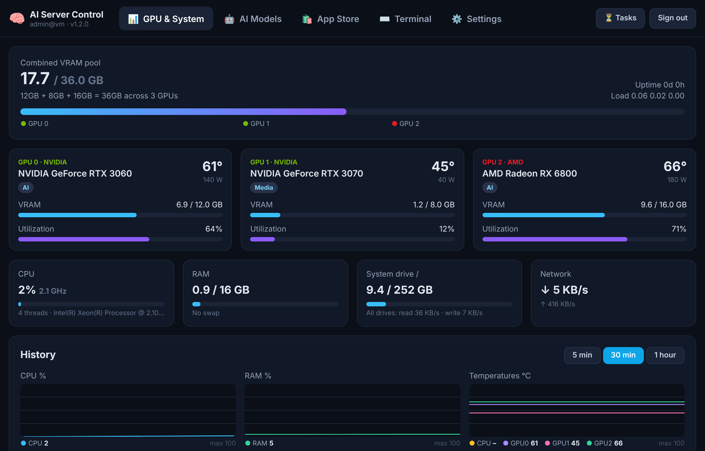
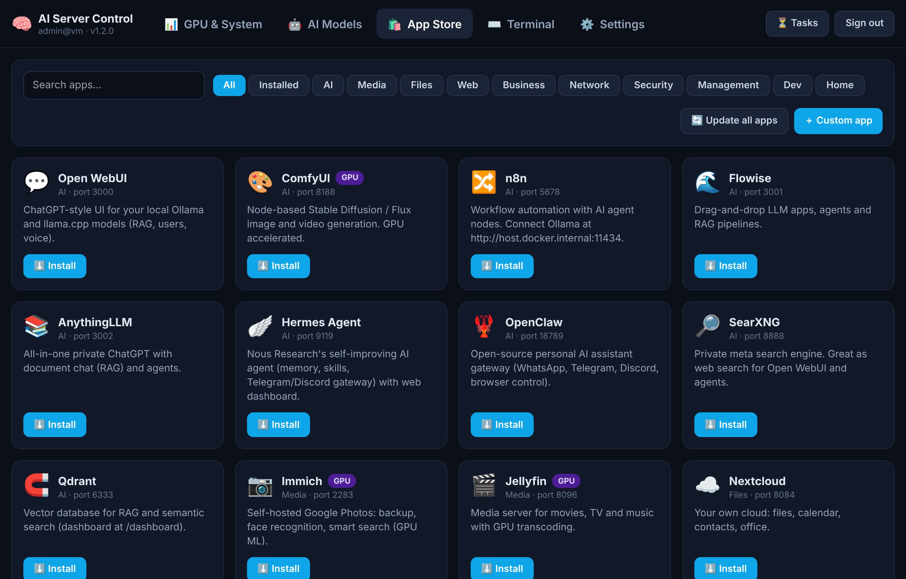
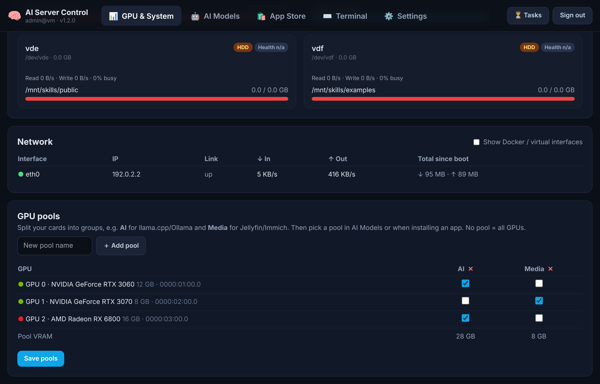

# AI Server Control Panel

**Turn any Ubuntu box with a pile of mismatched GPUs into a local AI server, managed from your browser.**

Pool an RTX 3060 + RX 6800 + old GTX 1080 into one big VRAM pool for LLMs, install Open WebUI, ComfyUI, Immich and 25 more apps with one click, and watch every GPU, drive and fan. No SSH needed.

```bash
curl -fsSL https://raw.githubusercontent.com/nnlahpai-ai-control-panel/ai-control-panel/main/install_app.sh -o install_app.sh
sudo bash install_app.sh
```



| | |
|---|---|
|  |  |
| **llama.cpp mixed-GPU pool**: NVIDIA + AMD + Intel in one model | **1-click App Store**: 48 apps with GPU passthrough |
|  |  |
| **GPU pools**: e.g. "AI" cards vs "Media" cards | **Browser terminal**: full root shell, no SSH |

*Screenshots use demo GPU data.*

**Feedback wanted!** If you try it, please [share a hardware report](../../issues/new?template=hardware_report.yml), [report a bug](../../issues/new?template=bug_report.yml), [request an app](../../issues/new?template=app_request.yml) or star ⭐ the repo. See [CONTRIBUTING.md](CONTRIBUTING.md).

---

A self-contained web panel for an existing Ubuntu Server 24.04 / 26.04. It manages local AI models, Docker apps, multi-GPU telemetry and a browser terminal, all on **port 1234**. It does not change the kernel and needs no custom ISO. It runs as systemd services under `/opt/ai-panel`.

It works the same on **Ubuntu Desktop** 24.04 / 26.04. The panel runs in the background, and you open it in any browser, on the machine itself (http://localhost:1234) or from another device.

## System monitor (all detected automatically)

The **GPU & System** tab finds every piece of hardware on its own. Nothing needs to be configured, and new drives, cards or network ports show up automatically.

| Section | What it shows |
|---|---|
| GPUs | Each card's name, VRAM, utilization, temperature and power, plus the combined VRAM pool |
| CPU / RAM | Usage, CPU temperature and clock, RAM and swap |
| History charts | The last 5 min, 30 min or 1 hour of CPU, RAM, temperatures, GPU load and VRAM, network and drive speed |
| Hardware | Motherboard, BIOS, CPU cores, each RAM stick (size, type, speed, slot), and the PCI cards (GPUs, network, storage controllers) |
| Drives | Every HDD, SSD and NVMe drive with its type, size, partitions and usage, live read/write speed and busy %, plus **SMART health** (healthy or failing), temperature, power-on days, SSD wear %, TB written, and warnings for bad sectors |
| Network | Every port with its IP, link speed, live in/out speed and totals. Docker and VPN interfaces are hidden unless you tick "show". |
| Fans | Fan RPM where the motherboard reports it |

Drive health uses `smartmontools`, and RAM stick details use `dmidecode`. The installer adds both. For even deeper monitoring with alerts, install **Netdata** or **Uptime Kuma** from the App Store.

## Files

| File | What it is |
|---|---|
| `install_app.sh` | 1-step installer and upgrader (Docker, NVIDIA toolkit, Ollama, llama.cpp Vulkan, systemd) |
| `app.py` | FastAPI backend (auth, Ollama, llama.cpp, App Store, GPU stats, WebSocket terminal, updates) |
| `apps_catalog.json` | 48 one-click apps |
| `index.html` | Dark-mode single-page dashboard |
| `static/` | Tailwind CSS and xterm.js served locally, so the panel works without internet in the browser |

## Install (3 lines)

On a fresh Ubuntu Server, run:

```bash
curl -fsSL https://raw.githubusercontent.com/nnlahpai-ai-control-panel/ai-control-panel/main/install_app.sh -o install_app.sh
sudo bash install_app.sh
echo "Open http://$(hostname -I | awk '{print $1}'):1234  (login printed above)"
```

The installer downloads the panel files from this GitHub repo. It also sets this repo as the panel's update source, so **Settings > Update panel** and **Refresh app catalog** pull your latest pushes.

Without internet access to GitHub, copy the folder over instead:

```powershell
scp -r "D:\Ai server Control" YOUR_USER@SERVER_IP:~/ai-panel      # run on Windows
```
```bash
cd ~/ai-panel && sudo bash install_app.sh                          # run on the server
```

The installer prints the URL and a random `admin` password. The password is also saved in `/opt/ai-panel/initial_password.txt`. Change it in **Settings** after your first login. If an NVIDIA driver was installed, reboot once.

Installer options: `--port 1234`, `--no-drivers`, `--update-engines`, `--source URL`.
Running the installer again upgrades in place and keeps your login, apps, models and settings.

## Mixed GPUs (NVIDIA + AMD + Intel together)

* **llama.cpp (AI Models > llama.cpp)** is the engine that pools *different vendors* into one model. The installer uses the official **Vulkan** build. Every card shows up as `Vulkan0`, `Vulkan1`, and so on. With **Tensor split = auto**, layers are split by each card's total VRAM: 8GB + 12GB + 16GB becomes `--tensor-split 8,12,16`, so 36GB is pooled. Use `fit` to let llama.cpp decide from free memory, or type your own ratio. **GPU layers = -1** lets llama.cpp fit as many layers as VRAM allows and puts the rest in RAM. That is how 30GB+ models still run.
* **Ollama** spreads a model across all GPUs of the **same** vendor (`OLLAMA_SCHED_SPREAD=1` is set). To try Ollama across vendors, uncomment `OLLAMA_VULKAN=1` in `/etc/systemd/system/ollama.service.d/ai-panel.conf` (experimental). Then run `systemctl daemon-reload && systemctl restart ollama`.
* llama-server exposes an OpenAI-compatible API at `http://127.0.0.1:8081/v1`. Open WebUI is pre-wired to both Ollama and llama.cpp.
* Docker apps that use a GPU (ComfyUI, Immich ML, Jellyfin) get NVIDIA (CUDA) *or* AMD (ROCm) passthrough. You choose which in the install dialog, because container images are vendor-specific.

### How many GPUs can be pooled?

| | |
|---|---|
| **Recommended** | **2 to 6 GPUs** (works best, easy to power and cool) |
| Software limit | about 15 mixed GPUs (llama.cpp Vulkan supports 16 devices, and 1 backend slot goes to the CPU) |
| Real limit | your motherboard slots and PCIe lanes, power supply and cooling |

Tips for a good pool:
* Any count and any sizes work, for example 8+12+16GB, 6+24GB or 4x16GB. The panel detects each server's cards and splits by its real VRAM.
* With the default **layer** split, the cards take turns, so x1 risers are fine. But the **slowest card sets the speed**. A small old card adds VRAM and can make generation slower, so only add it if you need the memory.
* Each card draws 150 to 450W. Size the power supply for all cards at full load plus 20%.
* Above 6 cards, expect more setup trouble (BIOS "Above 4G decoding" and "Resizable BAR", riser stability) and smaller speed gains per card.

### Multiple GPU pools (for example "AI" and "Media")

You can split your cards into named groups so that different work runs on different GPUs. For example:

| Pool | GPUs | Used by |
|---|---|---|
| **AI** | RTX 3060 12GB + RX 6800 16GB (28GB) | llama.cpp, Ollama, ComfyUI |
| **Media** | RTX 3070 8GB | Jellyfin transcoding, Immich face/photo AI |

How to set it up:
1. **GPU & System tab > GPU pools:** add a pool, tick its GPUs and click **Save pools**. Any number of pools works, and a GPU can be in more than one pool.
2. **AI Models > llama.cpp:** choose the pool in **GPU pool**, then click Start / Restart. The model splits only across that pool's cards.
3. **AI Models > Ollama:** choose the pool and click **Apply**. Ollama restarts and uses only those cards.
4. **App Store:** when you install a GPU app (or use ⋯ > Reconfigure), pick its **GPU pool**. Only that pool's cards are passed into the container.

Notes:
* GPUs are tracked by PCI slot, so pools stay correct after reboots, but update them if you move a card to another slot.
* "All GPUs" (no pool) is the default everywhere.
* A container uses one vendor, so for a mixed pool the app picks NVIDIA or AMD cards (the GPU passthrough option).
* After changing a pool's members, restart llama.cpp, click Apply for Ollama again, and Reconfigure the apps that use it.

## Getting models and apps in

* **Ollama:** 1-click library, or type any name (`qwen3:14b`, `hf.co/user/repo`). You can also turn any local GGUF into an Ollama model with the "→ Ollama" button.
* **llama.cpp GGUF:** from Hugging Face (type the repo and pick a quant), from any direct URL, or by uploading from your computer. Downloads resume if interrupted.
* **Custom Docker apps:** paste a compose file, load a `.yml` from your computer, or fetch one from a URL (GitHub links work). Use `${DATA_DIR}` for persistent folders.

## Keeping everything up to date

| What | How |
|---|---|
| One app | 🔄 button on the app card (pulls the latest image and recreates it, keeping data and passwords) |
| All apps | **App Store > Update all apps** (also refreshes each app's compose from the latest catalog) |
| Automatic nightly | Install **Watchtower** from the store (updates every night at 4 AM) |
| App catalog | **Settings > Refresh app catalog** (downloads the new `apps_catalog.json` from your update URL) |
| The panel itself | **Settings > Update panel** (downloads the new files, validates them, backs up the old ones to `/opt/ai-panel/backup/`, restarts) |
| Ollama + llama.cpp | **Settings > Update Ollama + llama.cpp** |
| Models | **AI Models > Update all** |

To add a new app for everyone, add an entry to `apps_catalog.json` in your GitHub repo, then click **Refresh app catalog**.

### Catalog entry format

```json
{
  "id": "my-app", "name": "My App", "category": "Web", "icon": "🚀", "port": 8100,
  "description": "One line shown on the card",
  "env": { "DB_PASSWORD": "{{random}}" },
  "inputs": [{ "key": "API_KEY", "label": "API key", "required": false, "secret": true }],
  "gpu": { "services": ["app"], "images": { "nvidia": "img:cuda", "amd": "img:rocm" } },
  "chown": { "uid": 1000, "dirs": ["data"] },
  "compose": "services:\n  app:\n    image: nginx\n    ports:\n      - \"${APP_PORT}:80\"\n    volumes:\n      - ${DATA_DIR}/data:/usr/share/nginx/html\n"
}
```
Variables available in compose: `${APP_PORT}`, `${DATA_DIR}` (`/opt/ai-panel/data/<id>`), `${TZ}`, `${HOST_IP}`, plus every `env` and `inputs` key. `{{random}}` and `{{random_hex}}` secrets are generated once and kept across updates. You can see them in **Settings > App secrets**.

## Security checklist

1. Change the admin password on first login.
2. The panel gives **root** access (terminal and Docker). Don't expose port 1234 to the internet. Use it on your LAN or VPN (WireGuard is in the store), or put it behind Cloudflare Tunnel with Cloudflare Access.
3. Login is rate-limited (8 failures per 5 minutes per IP). Sessions last 12 hours and end when the password changes. API calls require a CSRF header.
4. Ollama and llama.cpp listen on `127.0.0.1` only by default.
5. If `ufw` is active, the installer opens only the panel port.

## Services and paths

```
systemctl status ai-panel ai-llama ollama docker
journalctl -u ai-panel -f
/opt/ai-panel/config.json        login and settings (mode 600)
/opt/ai-panel/apps/<id>/         each app's docker-compose.yml + .env
/opt/ai-panel/data/<id>/         each app's persistent data
/opt/ai-panel/models/            GGUF files for llama.cpp
```

Reset a forgotten password:
`sudo /opt/ai-panel/venv/bin/python /opt/ai-panel/app.py --set-password admin NEWPASSWORD && sudo systemctl restart ai-panel`

## Notes on specific apps

* **Hermes Agent / OpenClaw:** run their one-time setup from the Terminal tab. The exact command is in the install dialog. For OpenClaw, if the dashboard isn't reachable on first start, check its logs. Its gateway bind setting may need `lan`.
* **Cloudflare Tunnel:** paste the tunnel token. In Cloudflare, point each public hostname at `http://localhost:<app port>`.
* **InvoicePlane:** finish the web setup wizard. The database host is `db`, and the credentials are in App secrets.
* **Vaultwarden:** browsers require HTTPS, so publish it through Cloudflare Tunnel or Nginx Proxy Manager.
* **Studio apps (Kdenlive, Shotcut, OpenShot, Blender, GIMP, Krita, darktable, digiKam):** these are full desktop apps that run in your browser. Log in as `admin`, and find the password in App secrets. They all share the folder `/opt/ai-panel/data/shared-media` (shown as `/media` inside the app), so a video you render in one opens in another.
* **MoneyPrinterTurbo:** add your LLM and stock-video API keys in its settings page. To keep it fully local, point the LLM at Ollama (`http://<server-ip>:11434`).

## Creative apps

| Group | Apps |
|---|---|
| **AI image** | ComfyUI (also makes AI video), InvokeAI, Fooocus |
| **Auto video** | MoneyPrinterTurbo: give it a topic and it writes the script, adds voice, subtitles and stock clips, then renders a short video |
| **Voice and text** | Whisper (speech to text and subtitles), Kokoro TTS (text to speech), LibreTranslate |
| **Video editing** | Kdenlive, Shotcut, OpenShot, HandBrake (convert and compress) |
| **Photo and 3D** | GIMP, Krita, darktable, digiKam, PhotoPrism, Blender |
| **Handy tools** | Stirling PDF, Paperless-ngx, IT-Tools, Excalidraw |
